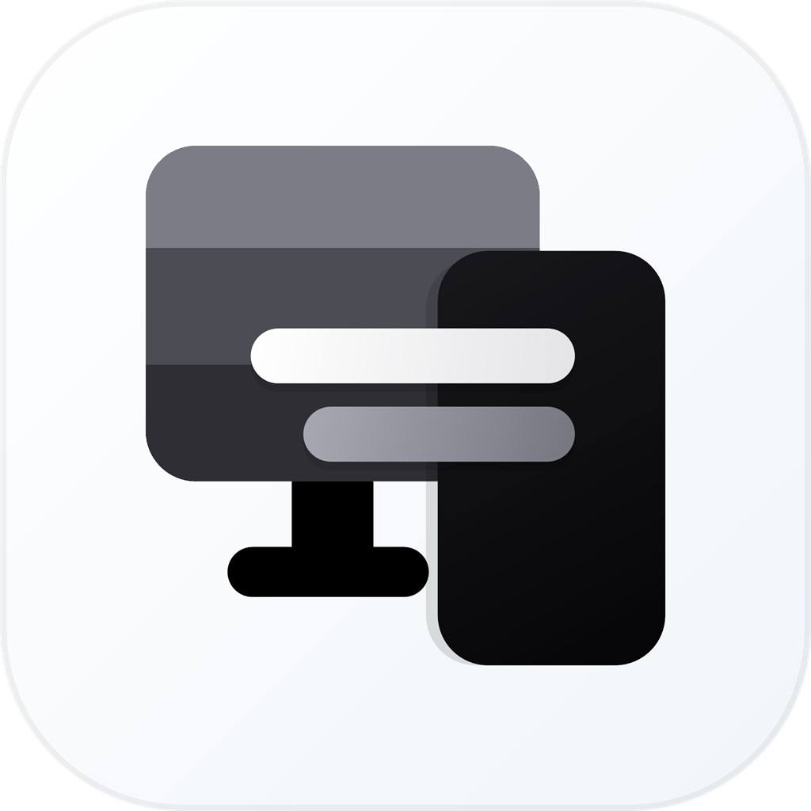

<p align="center">
  
</p>

<h1 align="center">Bridge</h1>

<p align="center">
  <strong>Android Remote Control &amp; Workspace Client for Windows and Linux PCs over LAN and Cloud Tunnel</strong><br />
  <span>Windows ve Linux bilgisayarlar için yerel ağ ve bulut tüneli destekli Android uzaktan kontrol istemcisi</span>
</p>

<p align="center">
  <a href="#english">English</a> · <a href="#türkçe">Türkçe</a>
</p>

---

<a id="english"></a>

## English

### Overview

**Bridge** lets you control and manage your Windows or Linux computer from your Android phone over the same local network (LAN/Wi-Fi), mobile hotspot, Tailscale, or a zero-configuration Cloudflare tunnel. Pairing uses a 30-second one-time 8-digit code generated directly from the PC system tray.

### Core Features

- **Low-Latency Remote Desktop & Trackpad:** Hardware-accelerated AV1 / H.264 streaming (`DXGI Desktop Duplication`), lossless region sharpening on static frames, native Windows touch injection (`InjectTouchInput`), 1:1 PC cursor rendering, full-screen laptop-style trackpad with velocity-sensitive pointer acceleration, double-tap drag-hold (`Left-Click Hold`), multi-monitor cursor traversal, and live keyboard input.
- **Scenes, Macros & Quick Actions:** Save multi-monitor window layouts as reusable Workspace Scenes, build multi-step macros (keyboard shortcuts, system/media actions, text typing, delays) executable from your phone, and create unified Quick Action buttons for apps, files, folders, URLs, macros, scenes, and system commands.
- **Display & Window Management:** Per-monitor power/blackout toggle and brightness drawer, display topology switching (extend, duplicate, single screen), live window moving/snapping across monitors and zones, and direct URL/search launching on the PC's default browser.
- **Media, Audio & Device Switching:** Windows GSMTC / Linux MPRIS media transport and seek bar synchronization, live Android media notification, audio output device switcher (`IPolicyConfig` / `pactl`), microphone mute toggle, and per-application volume mixer (`WASAPI` / `PulseAudio`).
- **Wireless Connectivity:** Scan and connect to PC Wi-Fi networks, and toggle PC Wi-Fi, Mobile Hotspot sharing, and Bluetooth adapters directly from your phone.
- **Bidirectional Wireless File Bridge:** Send files or photos from your phone straight to your PC (`Downloads` folder) with optional auto-open, or browse the PC file system to download files to your phone.
- **System, Power & Clipboard:** Real-time CPU/RAM telemetry, dynamic PC lock/unlock toggle (reflecting live lock status in both the app and Android Quick Settings tiles per paired PC), sleep, hibernate, restart, shutdown, scheduled power timer, Wake-on-LAN (WoL), and bidirectional clipboard bridge.
- **Customizable Modular Interface:** Long-press any page to enter edit mode, drag and reorder individual cards within or across tabs with magnetic snapping, or reset to the default layout at any time.
- **One-Click Auto-Update:** Built-in update checker and installer via GitHub Releases for Android (`Bridge.apk`), Windows (`Bridge.exe` / system tray), and Linux (`bridgectl update`).

### Installation

#### Windows (10 / 11 x64)

1. Run [`Bridge-Setup.exe`](Bridge-Setup.exe).
2. Once installed, the **Bridge** icon starts automatically in the Windows system tray.

#### Linux (Wayland & X11 — GNOME, KDE Plasma, Hyprland, Sway, wlroots, i3, XFCE, Cinnamon, MATE)

```bash
mkdir bridge && tar -xzf Bridge-Linux.tar.gz -C bridge
bash bridge/install.sh
```

Generate a pairing code, check service status, or update:

```bash
bridgectl pair
bridgectl status
bridgectl update
```

#### Android (7.0+)

Install [`Bridge.apk`](Bridge.apk) on your phone. Right-click the Bridge tray icon on your PC, select **Pair Device (Generate 30s Code)**, and enter the 8-digit code in the mobile app.

### Building from Source

```powershell
# 1. Install Node.js dependencies
cd pc-agent
npm install

# 2. Build Windows native binaries (BridgeHelper.exe and Bridge.exe)
powershell -ExecutionPolicy Bypass -File native\build-native.ps1

# 3. Build signed Android APK (Bridge.apk)
powershell -ExecutionPolicy Bypass -File ..\mobile-app\build-apk.ps1

# 4. Build Windows installer (Bridge-Setup.exe) and Linux package (Bridge-Linux.tar.gz)
iscc installer.iss
node linux\build-package.js
```

### Network Ports

| Port | Protocol | Scope | Description |
| :--- | :--- | :--- | :--- |
| `4850` | TCP | `0.0.0.0` | HTTP API and WebSocket server |
| `4851` | UDP | `0.0.0.0` | Local network device discovery (LAN Discovery) |
| `4852` | TCP | `127.0.0.1` | Local screen capture stream channel |
| `4853` | TCP | `127.0.0.1` | Local low-latency input injection channel |
| `4855` | TCP | `127.0.0.1` | Local Cloudflare tunnel ingress endpoint |

### Directory Structure

```text
├── Bridge-Setup.exe          Windows installer package
├── Bridge-Linux.tar.gz       Linux distribution archive
├── Bridge.apk                Android installation package
├── Bridge.exe                Windows system tray client
├── version.json              Release metadata and asset manifest
├── pc-agent/
│   ├── server.js             HTTP / WebSocket server and session manager
│   ├── installer.iss         Inno Setup installer script
│   ├── native/               Windows C# / Win32 / DXGI / WASAPI native components
│   └── linux/                Linux Wayland & X11 / PipeWire & PulseAudio / systemd components
└── mobile-app/
    ├── android/              Android native shell, media notification, and Quick Settings tiles
    └── www/                  Mobile web UI layer
```

---

<a id="türkçe"></a>

## Türkçe

### Genel Bakış

**Bridge**; aynı yerel ağ (LAN/Wi-Fi), mobil erişim noktası, Tailscale veya sıfır kurulumlu Cloudflare tüneli üzerinden Windows veya Linux bilgisayarınızı Android telefonunuzdan yönetmenizi sağlar. Görev çubuğundan üretilen 30 saniyelik tek kullanımlık 8 haneli kod ile güvenli şekilde eşleşir.

### Temel İşlevler

- **Düşük Gecikmeli Uzaktan Masaüstü ve Dokunmatik Yüzey (Trackpad):** Donanım hızlandırmalı AV1 / H.264 akışı (`DXGI Desktop Duplication`), durağan karelerde kayıpsız bölge netleştirme, gerçek Windows dokunma enjeksiyonu (`InjectTouchInput`), PC ile birebir (1:1) boyutta fare imleci, hıza duyarlı akıllı ivmelenmeli (pointer acceleration) tam ekran laptop tipi touchpad, çift dokunup basılı tutarak sürükleme (`Sol Tık Basılı Tutma`), çoklu monitör geçişi ve canlı klavye.
- **Çalışma Sahneleri, Makrolar ve Hızlı Erişim:** Çoklu monitör pencere düzenlerini Çalışma Sahnesi olarak kaydetme, telefondan tetiklenebilen çok adımlı makrolar (klavye kısayolları, sistem/medya eylemleri, metin yazdırma, gecikme) oluşturma ve uygulama, dosya, klasör, URL, makro, sahne veya sistem işlevleri için birleşik Hızlı Erişim butonları tanımlama.
- **Ekran ve Pencere Yönetimi:** Monitör bazlı güç/karartma ve ekran parlaklığı çekmecesi, ekran topolojisi değiştirme (uzat, yinele, tek ekran), açık pencereleri ekranlar ve bölgeler arasında taşıma ve varsayılan tarayıcıda doğrudan URL/web araması açma.
- **Medya, Ses ve Cihaz Seçimi:** Windows GSMTC / Linux MPRIS medya kontrolü ve zaman çubuğu (seek bar) senkronizasyonu, Android bildirim panelinde canlı medya oynatıcı, ses çıkış cihazı değiştirici (`IPolicyConfig` / `pactl`), mikrofon susturma ve uygulama bazlı ses mikseri (`WASAPI` / `PulseAudio`).
- **Kablosuz Bağlantılar:** Bilgisayarın Wi-Fi ağlarını tarama/bağlanma ve PC Wi-Fi, Mobil Erişim Noktası (Hotspot) ile Bluetooth adaptörünü doğrudan telefondan açıp kapatma.
- **Çift Yönlü Kablosuz Dosya Köprüsü:** Telefondan bilgisayara (`İndirilenler` klasörüne) tek dokunuşla dosya/fotoğraf gönderme ve PC Dosya Gezgini üzerinden bilgisayardaki dosyaları telefona indirme.
- **Sistem, Güç ve Pano Köprüsü:** Canlı CPU/RAM telemetrisi, dinamik ekran kilidi (hem uygulama içinde hem de Android Denetim Merkezi kutucuklarında her bilgisayarın gerçek kilit durumunu anlık yansıtır), uyku, hazırda bekletme, yeniden başlatma, kapatma, zamanlayıcı, Wake-on-LAN (WoL) ve çift yönlü pano köprüsü.
- **Özelleştirilebilir Modüler Arayüz:** Herhangi bir sayfada basılı tutarak düzenleme moduna geçme, kartları aynı sayfa içinde veya sekmeler arasında mıknatıslı sürükle-bırak ile taşıma ve istenildiğinde varsayılan düzene sıfırlama.
- **Otomatik Güncelleme:** GitHub Releases üzerinden Android (`Bridge.apk`), Windows (`Bridge.exe` / sistem tepsisi) ve Linux (`bridgectl update`) sürümlerini tek tıkla denetleme ve kurma.

### Kurulum

#### Windows (10 / 11 x64)

1. [`Bridge-Setup.exe`](Bridge-Setup.exe) kurulum paketini çalıştırın.
2. Kurulum tamamlandığında sistem tepsisinde (sağ alt görev çubuğu) **Bridge** simgesi otomatik olarak çalışmaya başlar.

#### Linux (Wayland & X11 — GNOME, KDE Plasma, Hyprland, Sway, wlroots, i3, XFCE, Cinnamon, MATE)

```bash
mkdir bridge && tar -xzf Bridge-Linux.tar.gz -C bridge
bash bridge/install.sh
```

Eşleştirme kodu üretmek, servis durumunu görmek veya güncellemek için:

```bash
bridgectl pair
bridgectl status
bridgectl update
```

#### Android (7.0+)

[`Bridge.apk`](Bridge.apk) dosyasını telefonunuza kurun. Bilgisayarda görev çubuğundaki Bridge simgesine sağ tıklayıp **Bağlantı Kur (30 sn Kod Oluştur)** seçeneğine basın ve ekrandaki 8 haneli kodu telefona girin.

### Kaynaktan Derleme

```powershell
# 1. Node.js bağımlılıkları
cd pc-agent
npm install

# 2. Windows yerel bileşenleri (BridgeHelper.exe ve Bridge.exe)
powershell -ExecutionPolicy Bypass -File native\build-native.ps1

# 3. İmzalı Android APK (Bridge.apk)
powershell -ExecutionPolicy Bypass -File ..\mobile-app\build-apk.ps1

# 4. Windows kurulum paketi (Bridge-Setup.exe) ve Linux paketi (Bridge-Linux.tar.gz)
iscc installer.iss
node linux\build-package.js
```

### Ağ Portları

| Port | Protokol | Kapsam | Açıklama |
| :--- | :--- | :--- | :--- |
| `4850` | TCP | `0.0.0.0` | HTTP API ve WebSocket sunucusu |
| `4851` | UDP | `0.0.0.0` | Yerel ağ cihaz keşfi (LAN Discovery) |
| `4852` | TCP | `127.0.0.1` | Yerel ekran yakalama akış kanalı |
| `4853` | TCP | `127.0.0.1` | Yerel düşük gecikmeli girdi kanalı |
| `4855` | TCP | `127.0.0.1` | Cloudflare tüneli yerel giriş noktası |

### Dizin Yapısı

```text
├── Bridge-Setup.exe          Windows kurulum paketi
├── Bridge-Linux.tar.gz       Linux kurulum arşivi
├── Bridge.apk                Android kurulum paketi
├── Bridge.exe                Windows görev çubuğu istemcisi
├── version.json              Sürüm ve dağıtım paketi üst verisi
├── pc-agent/
│   ├── server.js             HTTP / WebSocket sunucusu ve oturum yönetimi
│   ├── installer.iss         Inno Setup kurulum betiği
│   ├── native/               Windows C# / Win32 / DXGI / WASAPI bileşenleri
│   └── linux/                Linux Wayland ve X11 / PipeWire ve PulseAudio / systemd bileşenleri
└── mobile-app/
    ├── android/              Android yerel kabuğu, bildirim ve Hızlı Ayarlar servisleri
    └── www/                  Mobil arayüz katmanı
```
